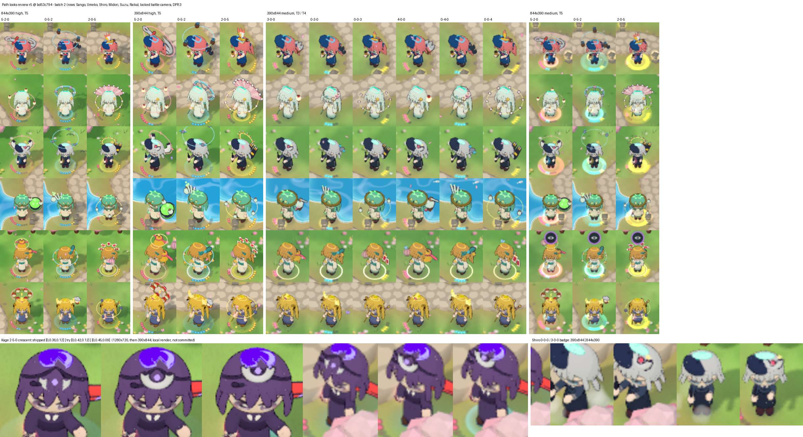

# Path looks, review round 5: batch 2 after the r4 fix

Reviewed: `feature/path-looks` at **`bd53c794`**. It is the r4 fix on top of `47769b8d` (batch 2: Sango, Umeko, Shiro,
Midori, Suzu, Raika). The merge base with `origin/main` is `d3508098`. I did not push to `main` or the feature branch.

**Verdict: OK.** The r4 finding is really fixed, both in the code and on screen. Batch 1 has not regressed. The gates
pass, and the change is still display only. There are two follow-ups: one LOW (the Kage crescent carried over from
v0.1.73) and one NIT. Neither blocks this branch.

Board: [`path-looks/r5-board.jpg`](path-looks/r5-board.jpg). It is 286 KB and holds these crops:
- the six girls at T5 on every path: 844×390 and 390×844 at high, and 844×390 at medium;
- 390×844 medium at T3 and T4 on every path;
- the Kage crescent: as shipped, plus two offsets I tried;
- Shiro's T3 badge.

## 1. The r4 finding (muzzle "hidden" masked piece blocks)

**Code.**
- The check now lives in `src/render/pathLooks/muzzle.js`.
- The "own figure" list leaves out three kinds of mesh:
  - every mesh already in the piece list;
  - every outline;
  - every mesh that has an ancestor named `pathLook*` (checked up to `model.parent`).
- `mergedPieces` now names the merged meshes `pathLookMesh` and `pathLookHull`.
- Either rule alone would close the r4 hole, and having both is good.
- `holders` is the merged group plus the holder bones that `mergedPieces` adds. None of them contains her body meshes, so
  the opposite mistake (counting her body as a piece) cannot happen either.
- The new unit test stages a piece mesh with an **empty name** under a `pathLook:merged` group. That is exactly the r4
  shape. The test asserts:
  - a block by the piece alone reports `'p1_drones'`, not `'hidden'`;
  - her figure in front of the tip reads `'hidden'`;
  - a piece behind the tip does not block.
- `BattleRenderer.pathLooksMuzzleBlocked` now only delegates to the new module.

**The e2e change is also right.** Each girl now gets her own one-girl formation page. A girl who cannot be placed fails
the run instead of being skipped silently, and `--muzzleFrames` sets the length of the sweep.

**Shiro's drones.**
- `p1_drones` now orbits at root `[0, 1.22, 0]`, scale 1.1. Before it was 0.95 and 1.0.
- On screen the T5 ring sits well above her beret at 844×390 and 390×844, on high and on medium (board, Shiro row,
  `0-5-2`).
- It no longer crosses her head or the rifle line, as it did on the r4 board.

**Muzzle runs (all on `bd53c794`).** In every run below, the run's "hidden" count is the only place a piece-caused block
could still be excused.

| Run | 390×844 | 1280×720 |
| --- | --- | --- |
| `--only muzzle`, all 15 girls (30 frames a set) | Aoi, Akane, Yuki, Momo, Sango, Shiro, Raika 180/180; Luna, Nami 90/90; **Umeko 175/180 + 5 hidden**; 0 blocked | the same girls all clear, Umeko 180/180; 0 blocked |
| `--only muzzle --muzzleFrames 100 --girls shiro,umeko` | **Shiro 600/600**; Umeko 579/600 + 21 hidden, 0 blocked | **Shiro 600/600**; Umeko 600/600 |

Notes on the runs:
- Rei, Kage, Hikari, Midori and Suzu have no muzzle anchor, so the script skips them.
- My first all-girl run hit my 30-minute shell limit after Midori at 1280×720. I re-ran the remaining two girls, Suzu
  and Raika, with `--girls suzu,raika`: Raika was clear in 180/180 at both sizes, and the run printed "all checks
  passed".
- With the fixed rule, a piece on the ray that her figure does not hide fails the run. So 0 blocked frames now really
  means no piece hides a visible muzzle.
- Umeko's hidden frames match the author's numbers (18 of 600; I measured 21, a different sample of the same idle and
  attack sway). They are portrait only and are caused by her staff head swinging behind her own head. A piece cannot
  hide what her head already hides.

## 2. Batch 1: no regression

The fix changes only three things:
- the names of the merged meshes;
- where the muzzle check lives;
- one catalog row (Shiro's `p1_drones`).

Batch 1 results:
- **Muzzle:** every armed batch-1 girl is clear at both sizes. That is Aoi, Akane, Yuki and Momo at 180/180, and Luna and
  Nami at 90/90 (the table above).
- **Draw calls:** the hull is still `isOutline`, so it stays out of both raycast lists. The draw path and the draw-call
  budget do not change.
- **Tests:** `tests/render` passes, including the batch-1 catalog, GLB, socket and draw-call tests (§5).

## 3. Render-and-look pass, batch 2

**Setup:**
- One real battle (stage 1-2) with the locked battle camera. All six girls were placed with `sim.placeTower` and drawn
  through `setPathLookOverride`.
- Every path at T3, T4 and T5: 3-0-0, 4-0-0, 5-2-0, 0-3-0, 0-4-0, 0-5-2, 0-0-3, 0-0-4 and 2-0-5.
- Viewports 844×390 and 390×844 at DPR 3, on high and on medium graphics: 36 full frames and 216 girl crops.
- The pieces matched the catalog in every set, with 0 page errors and 0 console errors.
- I zoomed into the crop edges and every girl's head, hands, back and feet.

**Results:**
- **Each path reads, at every tier and on both qualities.**
  - Medium differs from high only in the ground aura: it is stronger and more saturated on medium. The silhouettes and
    colours of the pieces are the same.
  - The violet eye icon above Suzu in some 844×390 crops is the battle's own map marker, not a path-look piece.
- **Faces:** no batch-2 piece covers a face from either camera.
  - Head pieces sit on top, at the back, or to the side: Sango's spyglass and plume, Umeko's blossoms, Midori's test
    tubes beyond her hat brim, Suzu's ribbons and Raika's bolt and sparks.
  - The orbits pass at chest or waist height (Umeko's pearls, Midori's bottles, Raika's orbs) or above the head
    (Sango's mortars, Umeko's lanterns, Shiro's drones and halo, Suzu's bells and seals, Raika's drums).
- **Clipping and floating:**
  - Nothing sinks into the bodies. Floaters stay at the side: Midori's cauldron and fumes flask, Sango's bombs,
    Shiro's T3 drone, and Raika's storm cloud on her left.
  - The back pieces sit behind the shoulders on both cameras: Sango's shells and anchor, Midori's alembic, Shiro's
    magazines and moon, and Suzu's bell.
  - Suzu's T5 great bell and Raika's T5 drum ring float clearly above the head in portrait. Neither clips the hair.
- **Colours:**
  - The pips use the shared path colours (pink, cyan and gold).
  - The T5 auras match the path: pink-orange for 5-2-0, cyan for 0-5-2 and gold for 2-0-5.
  - No piece clashes with an outfit or goes missing against the grass or water.
- **Content:** every piece is a prop or a friendly floater: shells, an anchor, bombs, a spyglass, lanterns, blossoms,
  pearls, a clam, a badge, a moon, drones, magazines, glassware, bells, ribbons, seals, a bolt, drums, a cloud, sticks
  and orbs.
  - Nothing is clothing on the body.
  - No student is sexualised.
  - The camera frames the girl and her props, not her body.
  - The catalog, the spec and the commit name no other games or anime.

## 4. Display only

- `git diff d3508098..HEAD --stat -- src/sim src/online src/data` is **empty**.
- The whole branch diff since the merge base touches only `src/render/**`, `public/models/pathlooks/*.glb`, `e2e/`,
  `tests/render/`, `docs/` and `tools/blender/`.
- `simId()` = **`e4001588f40b`**, as required. `COOP_PROTOCOL` is untouched.

## 5. Tests

- `npx vitest run tests/render tests/models --maxWorkers=2`: **71 files, 977 tests, all pass**.
- `tests/render/pathLooks.test.js` alone: 18/18. That includes the four new muzzle-check tests.
- No other test file mentions path looks.

## 6. Carry-over from the v0.1.73 live check: Kage 2-5-0's `p1_crescent`

**Setup:**
- Close renders from the locked 48° battle camera, high, DPR 3, at 1280×720 and 390×844.
- Kage at 0-0-0 and at 2-5-0 (board, bottom left).

**Answer: it does not cover her eyes or face, but it is buried in her fringe.**
- At `[0, 0.36, 0.12]` the crescent's centre sits inside the fringe, just under the headband line.
- Only its two white tips and the violet gem poke out. The arc itself is hidden in the hair.
- The eyes below the fringe stay visible.
- At about 25 px a head, as on the live check, the three flecks merge into a light vertical mark in the middle of the
  upper face. That is what the live check saw.
- So the crescent does not hide her face. But it does not read as a crescent either, and it is not "on her headband" as
  the spec says.

**The fix I tested:**
- I edited a scratch copy of the tree, rendered it and did not commit it.
- `[0, 0.42, 0.12]` puts the whole crescent on the headband line, with the gem on it. It reads as a crescent at both
  sizes, and its lower edge stays above the eyes.
- `[0, 0.45, 0.09]` also works, but in portrait it starts to overlap her purple hair ornament.
- Kage has no muzzle anchor, so the muzzle gate does not apply.

## Findings

1. **LOW: Kage's Shadow Mark T5 crescent is buried in her fringe** (`src/render/pathLooks/catalog.js`, the `kage`
   row, path 1 t5).
   - This was shipped in v0.1.73 and is not part of batch 2.
   - From the battle camera only the two tips and the gem show. At phone size they read as a light streak down the
     centre of the upper face.
   - **Fix:** change `P('p1_crescent', 'head', [0, 0.36, 0.12], [0, 0, 0], 1.6)` to
     `P('p1_crescent', 'head', [0, 0.42, 0.12], [0, 0, 0], 1.6)`, verified by render (§6).
   - Re-run `e2e/path-looks.mjs --only close --girls kage`, and update the Kage row of spec §5 if you reword it.
   - It can ride this branch or the next display-only release. It does not block batch 2.
2. **NIT: Shiro's Execution badge is not "on her beret"** as the spec says.
   - `p0_badge` at `[0.1, 0.42, 0.06]` sits on her hair at the left temple. Her navy beret covers the other side.
   - In the 390×844 view it shows at the side of her head, above the fringe, as a red disc that reads a little like a
     big eye (board, bottom right). It does not cover her face.
   - **Fix:** either reword spec §5 to say "on her hair, opposite her beret", or move the badge onto the beret. I did
     not test a beret offset. Try about `[-0.1, 0.44, 0.04]`, then re-run `--only close` and `--only muzzle` for
     Shiro, since the beret is on her rifle side.

## Method

- **Tree:** `bd53c794` in an isolated worktree. Chromium ran on SwiftShader, and every browser run went through the
  machine's browser cap.
- **The author's `e2e/path-looks.mjs`:**
  - `--only muzzle` for all 15 girls (the run ended at my 30-minute limit after Midori at 1280×720);
  - `--only muzzle --girls suzu,raika` for the rest;
  - `--only muzzle --muzzleFrames 100 --girls shiro,umeko`.
- **My own render driver** (scratch, not committed): six girls on one board, nine tier sets, two viewports, two
  qualities.
- **A Kage and Shiro close driver.** For the crescent offsets it used a scratch copy of the tree, with the offset edited
  there only.
- **Targeted vitest**, as in §5.
