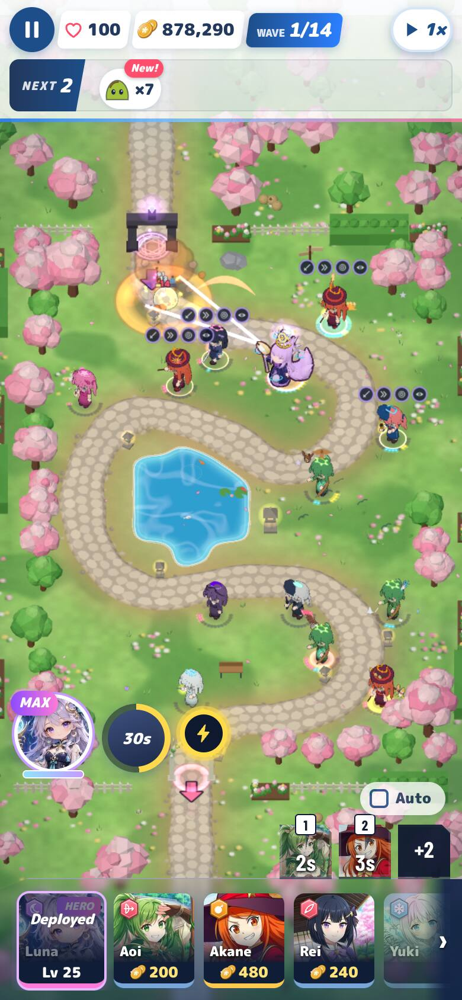
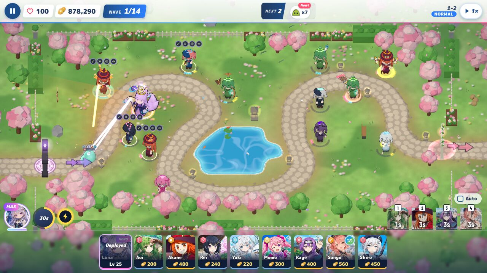
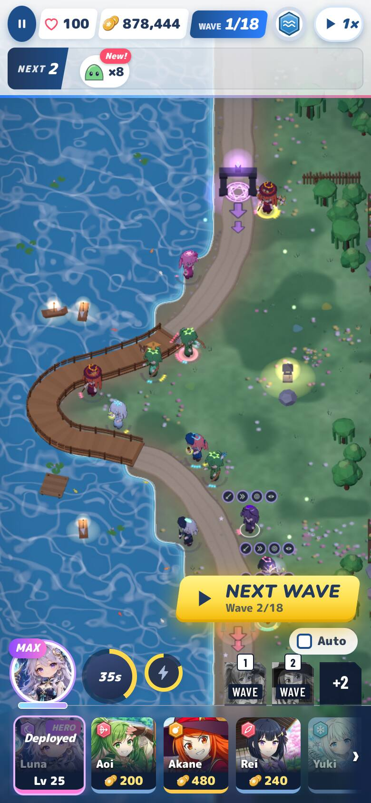
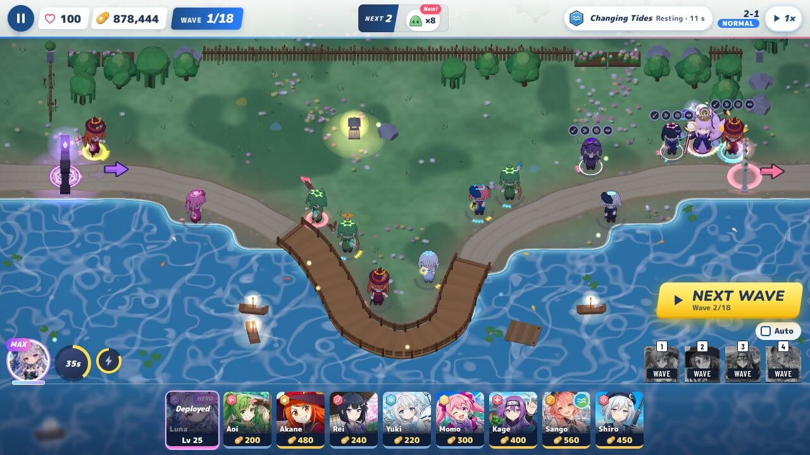
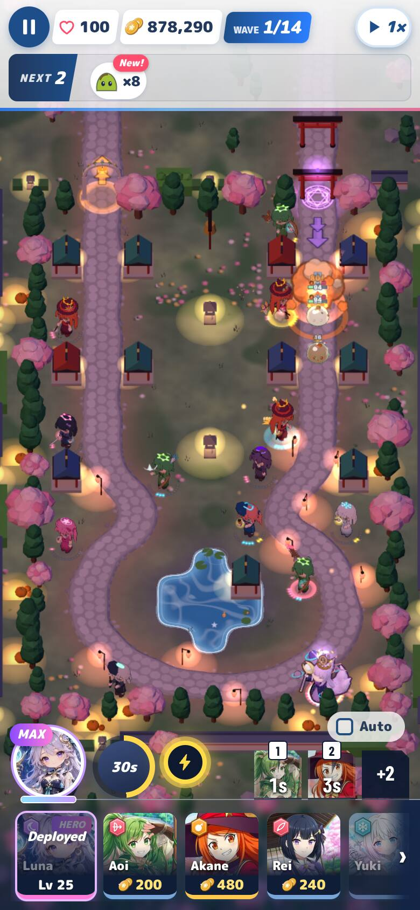
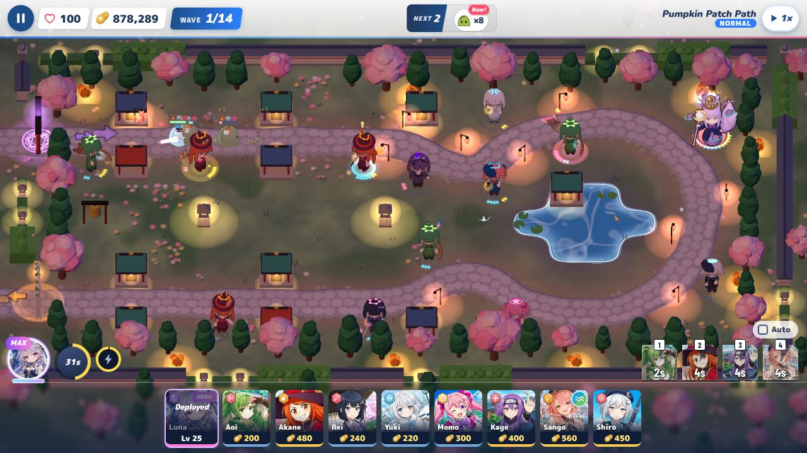
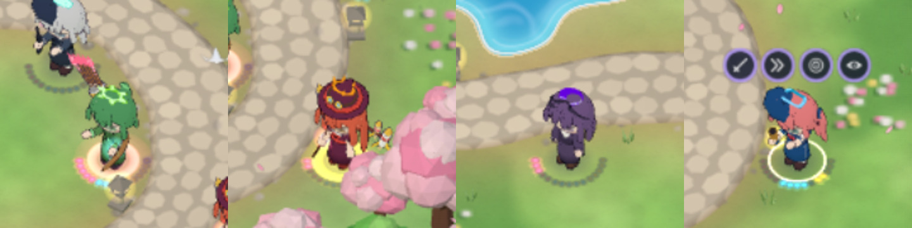
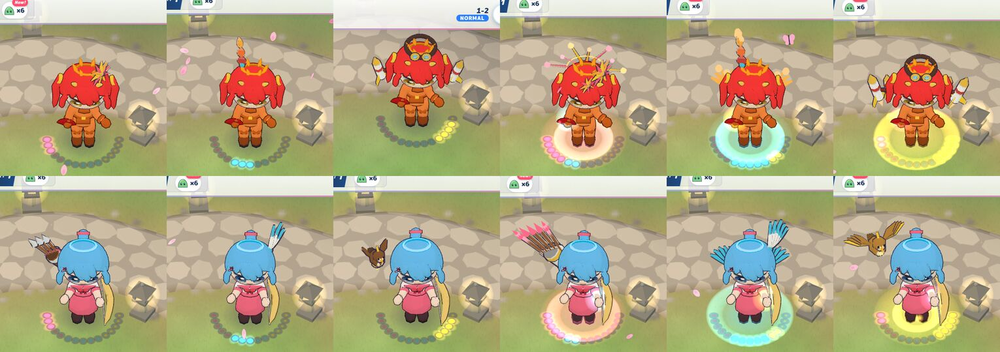

# Path looks, review round 1

Reviewed: `feature/path-looks` @ `04d8588b` (spec `docs/specs/path-looks.md`, CONTRACTS §7 note), merged onto `main`
@ `2dba8b4a` (v0.1.71) in a scratch worktree. Nothing was pushed to `main` or the feature branch.

**Verdict: OK to merge as the Phase 1 prototype (display only).** No HIGH findings. One MEDIUM: the draw-call
cost has to come down before the rollout batches. That cost grows with every girl who gets pieces. The LOWs can
land with batch 1.

## 1. Merge onto v0.1.71

- `git merge --no-ff origin/feature/path-looks` on `2dba8b4a` merges cleanly. `CONTRACTS.md`, `src/models/glbChibi.js`
  and `src/render/actors.js` auto-merged. v0.1.71 touched different hunks: `attachWeaponTip` and the one-shot fade in
  glbChibi, the rigid-face `squashModel` in actors, and `costumes.js`, which path looks does not touch.
- **Weapon tips still resolve.** With pieces on, `towerModelInfo(uid).anchors.muzzle` is set for Aoi (bow, `hand_L`
  centre), Akane (staff, `hand_R` far) and Luna (staff, `hand_R` up). `attachWeaponTip` measures once, at
  instantiate. That is before any piece exists, and it only reads skinned meshes. Pieces are plain meshes under
  their own holders, so they cannot shift the measured tip. They don't parent the prop or move a bone either.
- **No piece blocks a muzzle.** I ran a geometric ray test (Möller–Trumbore) from the battle camera to the live
  muzzle against every piece triangle. It covered 60 frames per set, idle plus one attack swing, at 390×844 (portrait camera)
  and at 1280×720. Sets tested: Aoi and Akane at 5-2-0, 2-0-5, 0-5-2, 4-0-0, 0-4-0 and 0-0-4, and Luna at 3-3-3,
  4-4-4 and 5-5-5. That makes **0 occluded frames out of 1,800**.

## 2. Sim id

`simId()` is **`e4001588f40b`** on the merged tree, the same as `main`. No file in `src/sim`, `src/online/coop` or
`src/data/coop.js` changed. `COOP_PROTOCOL` stays at 17, and no bump is needed.

## 3. In the real game

Each board is a real battle (`sim.upgradeTower`, not the override) with 13 girls and a wave running:
Aoi 5-2-0 / 0-3-0 / 0-2-4, Akane 2-0-5 / 0-5-2 / 3-0-0, Rei 2-1-0, Yuki 0-0-2, Momo 1-0-0, Kage 3-0-0, Sango 0-4-2,
Shiro 0-0-0 and Luna at Lv 25. Phone shots are at DPR 2 with the portrait camera. There were 0 page errors in every run.

| Stage | 390×844 | 1280×720 |
| --- | --- | --- |
| 1-2 (day) |  |  |
| 2-1 (night) |  |  |
| ev-halloween-1 (lantern night, costumes) |  |  |

Phone pips at device pixels (Aoi 5-2-0, Akane 2-0-5, Kage 3-0-0, Sango 0-4-2): 

- **Readable at phone size: yes for the path, partly for the tier.** Every girl's path reads from colour: the filled
  pips, plus the aura at T5. The aura is the strongest signal on the board. T5 silhouettes read clearly: comet
  quiver, falcon, flame wings, rocket pack, Luna's crown and orbiting moons. T3 and T4 pieces are small at
  390×844. Aoi's falcon and feathers are clear. Akane's pinwheel and plume are subtle against her own hat (LOW-2).
  On desktop every piece reads.
- **Pieces follow the clips** (author's idle, attack and walk frames, and my 60-frame runs). They stay clear of faces
  in every board, phone crop and outfit shot. Hat pieces ride the top of the hat, and goggles sit on the hat or the
  hair, never on the eyes. I saw no bad clipping on the default outfits. On Sentinel Akane the head pieces sink a
  little into her hair (LOW-1).
- **Pips with 13 girls:** filled pips are compact and colour-coded. They don't fight the ability badges or the hero
  ring. The 15 dark sockets add a faint dashed ring under *every* girl, even 0-0-0 Shiro. On day grass that is
  mild noise across a full board (LOW-3). On the two night stages the sockets almost vanish and the filled pips pop.
- **Halloween:** event costumes are monsters-only (`costumes.js`). Girls never wear event headwear, so nothing on
  the girls can collide with Luna's tiara or crown. On the Halloween stage the costumed monsters and the girls' pieces
  render together without problems. The crown, crown stars and orbit moons read well under the lantern light. Akane's
  own witch hat is the case that does exist, and her pieces sit on its band and above its brim as the spec says.
- **Outfits (Sentinel Style)**, checked because the catalog offsets are measured on the default rig:
  
  Aoi's sentinel outfit wears every piece cleanly. Akane's sentinel outfit has no witch hat, so her hat-band
  pieces land on her hair top (LOW-1).
- **Sell, upgrade and swap** (my lifecycle run at 1280×720):
  - Upgrades swap pieces in place: 3-0-0 `p0_quiver` → 4-0-0 `p0_quiver p0_comet` → 5-2-0 `p0_cometQuiver`, with
    the path 2 glow at her bow hand. Akane 1-2-0 shows `1:weapon` and `0:off` glows and no pieces.
  - Selling removes every socket. Five place → T4 → sell cycles leave 0 sockets and the frame's draw calls back at
    the same count (17) each time.
  - Swapping (sell Akane, place Aoi on her tile) gives a T0 Aoi with no inherited pieces or glows.
  - Luna levels Lv 5 → 25: `[1,1,0]` none; `[2,2,3]` tiara; `[3,3,3]` lances, orbs, tiara; `[4,4,4]` lances5,
    orbs3, tiaraStars; `[5,5,5]` crescent, horizon, crown, crownStars.
  - `disposeObject` skips the shared piece geometry and materials (`userData.shared`), so selling never frees
    another girl's pieces.
- **Lazy loading: confirmed.** There are no `/pathlooks/` requests at placement or at T1–T2. `aoi_p0.glb` is
  fetched only at the T3 purchase, and only the file for that path. A hero fetches each path's file as that path
  reaches T3 (Lv 10: `luna_p2` only).

## 4. Performance (low tier)

On the merged tree I reproduced the author's mixed board: 12 girls at quality low, **60 → 81 draw calls (+21)**,
+7,354 triangles (531 a girl). The layer's own CPU cost is 0.2 ms a frame (p95 0.3).

**Worst case: the same 12 girls, all at T5** (5-2-0 / 2-0-5 / 0-5-2, Aoi and Akane): **60 → 92 calls (+32, +53 %)**,
+13,064 triangles (988 a girl). The author's own perf gate (≤ 24 calls) fails on this board. Luna at Lv 25 adds 4 more
pieces. In software rendering, looks-on was slower in every pair: about +6–9 % frame time (390 → 416 ms mixed,
352 → 386 ms all-T5). That is SwiftShader, so it is no phone number, but "within noise" in spec §7 undersells it.

**Judgement: +21 is fine for Phase 1,** where only Aoi, Akane and Luna wear pieces. It is **not fine as the rollout
baseline**. After batch 6 every girl wears pieces, late waves are mostly T3+, and co-op doubles the girls, so a real low-tier
board heads toward +40–60 calls on a ~60-call frame (MEDIUM-1). Merging is needed before rollout, but not for this merge.

## 5. Content

Pieces are quivers, feathers, a friendly falcon, pinwheels, a plume, a rocket pack, goggles worn on the hat, moon
lances, little moons and a tiara or crown. They are cute and wholesome. Nothing is clothing, nothing is body-hugging,
and nothing frames a body. Luna's (adult hero) pieces are head, back and orbit pieces only, as spec §6 requires. No
faces are covered. Names in the catalog, file names, Blender script and spec are generic. I found no other games' or
anime names and no third-party images. The rules in §6 and HANDOFF §6 are met.

## 6. Tests (merged tree)

| Check | Result |
| --- | --- |
| `npm test` (vitest) | **446 files passed, 2 skipped; 7,095 tests passed, 11 skipped** |
| `node e2e/path-looks.mjs --only close,phone,perf --quality medium` | **all checks passed** (close-ups for 3 girls × 7 sets, the real phone battle, perf +21) |
| `node e2e/smoke.mjs` (1280×720, 844×390, 390×844) | **ALL SMOKE CHECKS PASSED** (681 ok, 0 fail). The SSR flake was hardened on main in v0.1.71. |
| My review runs (lifecycle, stages, outfits, muzzle raycast, all-T5 perf) | 0 page errors. The all-T5 perf board fails the author's ≤ 24-call gate (MEDIUM-1). |

## 7. Findings

- **MEDIUM-1: the draw-call cost scales with the rollout.** +32 calls for 12 T5 girls on low (§4). Before rollout
  batch 1, do the step spec §7 already names:
  1. make glow a vertex flag in the toon material, so each piece is one mesh;
  2. merge each girl's static pieces that share a bone, keeping the animated ones (`spin`, `bob`) separate;
  3. add a perf gate on an all-T5 board (for example ≤ 16 calls for 12 girls on low, ≤ 2 a girl), not just the
     mixed board.
- **LOW-1: outfit offsets.** Akane's `head` offsets assume her witch hat. On `sentinel-akane` (no hat) the pinwheel and
  goggle band sink into her hair top. They are still clear of the face. Add the per-skin catalog row
  (`skins: { akane_sentinel: … }`, spec §3) when her batch is touched, and make "check every owned outfit" part of
  each batch's close-up pass.
- **LOW-2: T3 size on phones.** Akane's T3 hat pieces (pinwheel, plume) are hard to tell apart at 390×844. Scale them
  about 1.2× or give them a brighter glow part. The rest read.
- **LOW-3: dark pip sockets on every girl.** Draw sockets only for paths with at least one tier (0-0-0 shows nothing,
  as the old ring did below T3), or dim them further on day stages. That keeps a full board quieter while the gauge
  still reads.
- **LOW-4: spec §7 wording.** Replace "frame time within noise" with the measured +6–9 % in software rendering, and
  note the all-T5 numbers.
- **NIT:**
  - `Actors.setShadows` sets `castShadow` on piece glow meshes too. Pieces built later only cast from bodies, so
    the two disagree. Skip `userData.fx` meshes there.
  - `PathLooks.overrides` keeps entries for sold uids. It is a staging-only API, but clearing an entry on sell is free.
  - The hero ring now scales with `v.scale / TOWER_SCALE`. That change is intentional and harmless; mention it in the
    patch note.

## 8. Owner decisions: recommendations

1. **One shared path colour set: yes, use the board set (pink `#ff6b8b`, cyan `#4cc9f0`, yellow `#ffd43b`).** On the
   board the colours have to hold up on day grass, at night and under lantern light, and next to each other in a
   2 cm gauge. These three do, in every shot above. The drawer's blue `#3b8cff` and violet `#9b6bff` would be the
   pair hardest to tell apart on the board, and violet sinks on the night stages. The drawer change is UI only:
   `PATH_COLORS` in `src/ui/battle/drawerView.js` and `--path` in `battle.css`. The VAULT_BRIEF §2.4 line should be
   updated with it. Check the yellow edge on the drawer's light card. If it is weak there, use a deeper yellow of the
   same hue for the drawer's edge only.
2. **Pips replacing the max-tier ring: yes.** The ring said "how far" in one colour per tier. The pips say which
   path and how far, and the T5 aura brings back the old "maxed" glow more strongly. The hero keeps her gold ring
   with her pips on it, which reads well. Take it with LOW-3, so girls with no tiers draw no gauge, the way the old
   ring was absent below T3.

## Method

Scratch worktree of `main` + `feature/path-looks`, run under Chromium + SwiftShader. I used the author's
`e2e/path-looks.mjs`, plus review-only scripts that were not committed:
- lifecycle and lazy-load request log;
- 3 stages × 2 viewports on real boards;
- Sentinel outfits;
- camera → muzzle raycast;
- an all-T5 variant of the perf section.
