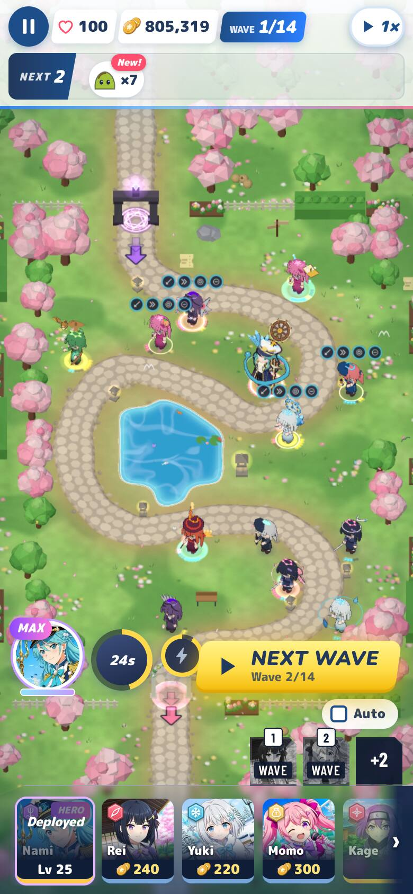
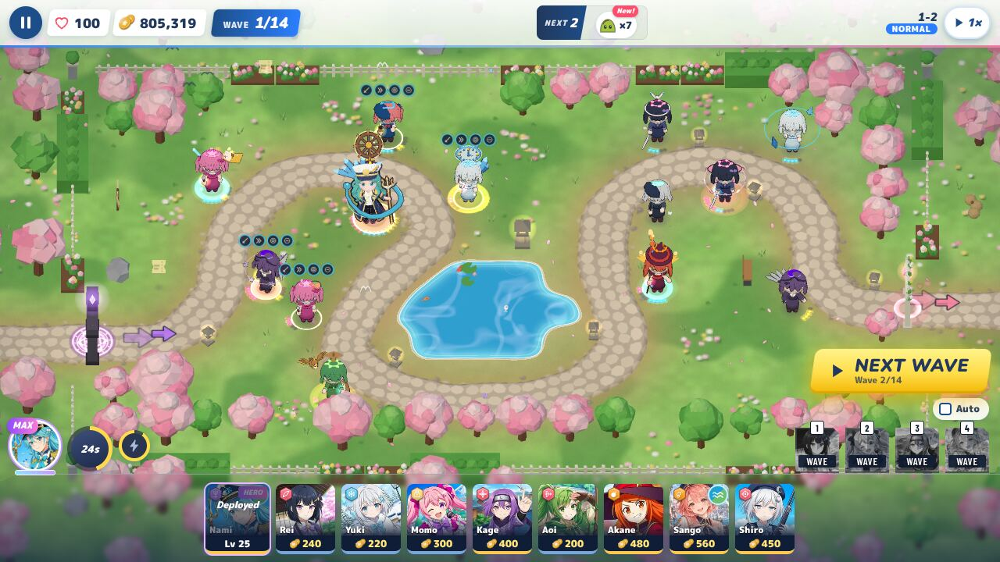
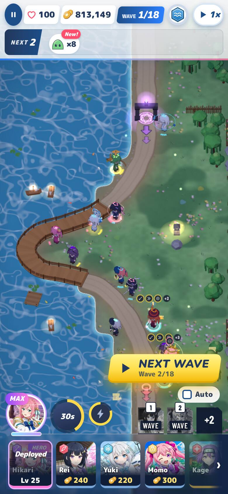
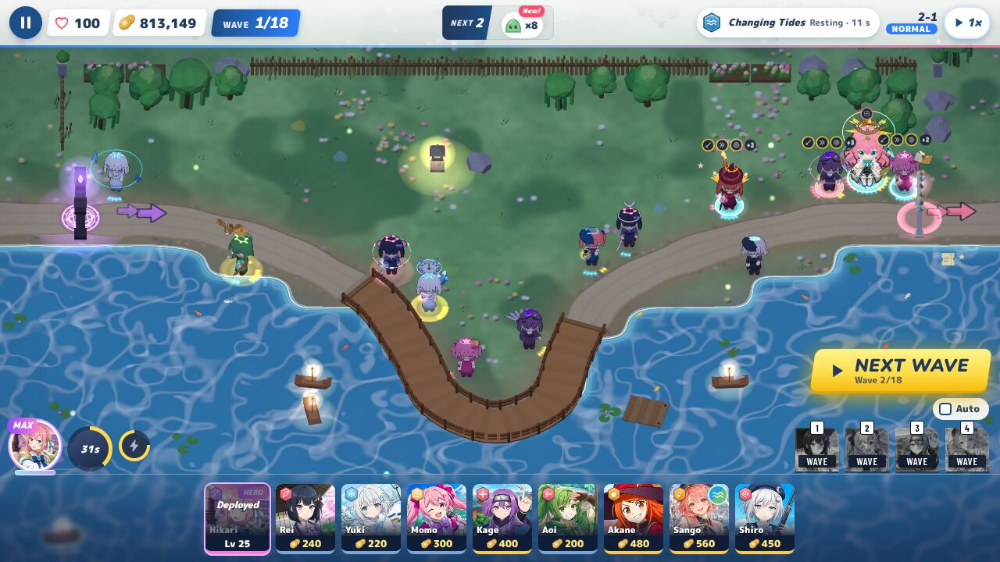
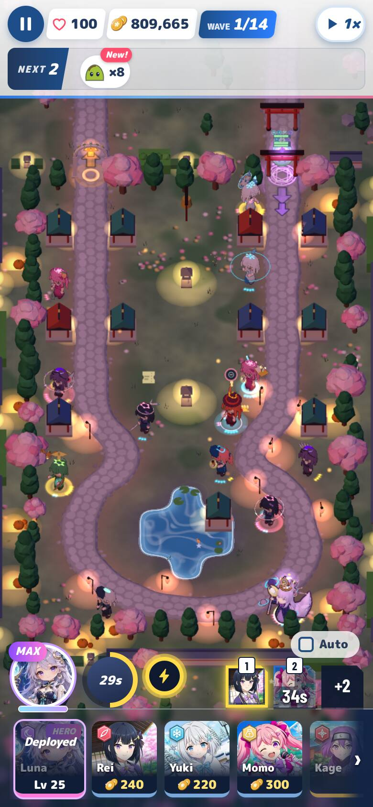
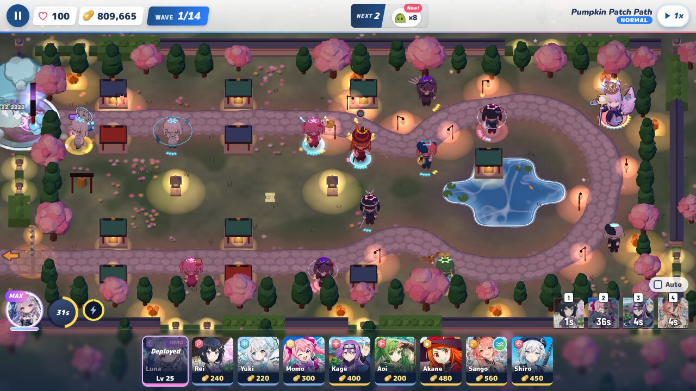
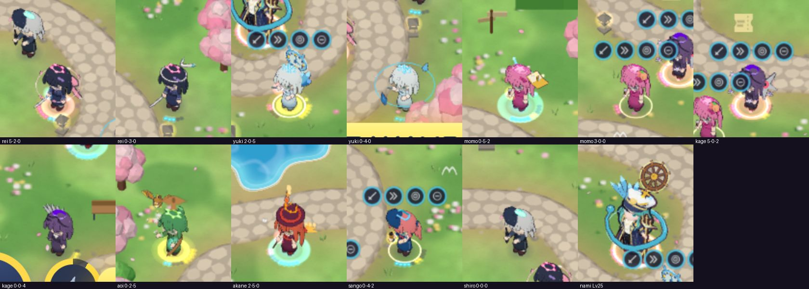
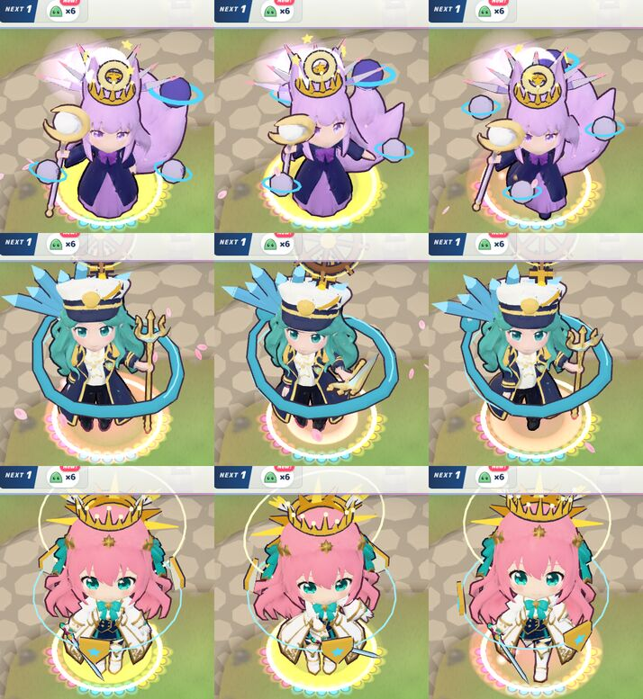
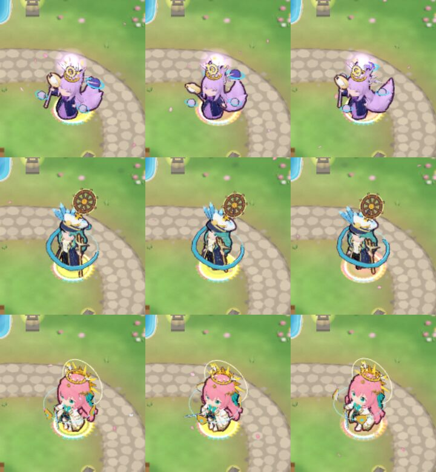
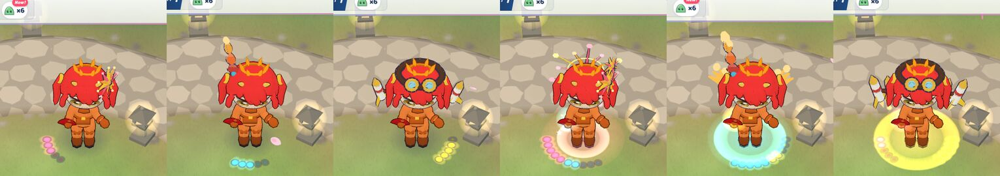

# Path looks, review round 2

Reviewed: `feature/path-looks` @ `b7e114ce`. That commit is the r1 fixes plus rollout batch 1 (Rei, Yuki, Momo, Kage,
Nami, Hikari), on top of the merge of `main` @ `2dba8b4a` (v0.1.71), so no extra merge was needed. I tested in a
scratch worktree and did not push to `main` or the feature branch.

**Verdict: OK to ship** (after v0.1.72). All r1 findings are fixed. The draw-call gate holds on the board it was set for.
Batch 1 reads on both viewports, keeps faces and muzzles clear, and is wholesome. Three LOWs and two NITs remain; none
blocks the ship.

## 1. Round-1 findings

| r1 finding | r2 | Verified |
| --- | --- | --- |
| MEDIUM-1 draw calls | Static pieces are merged into one skinned mesh on her skeleton. Glow is a per-vertex flag (`aGlow`) in one toon material. Each animated piece keeps its own mesh. | **Fixed.** All-T5 board (6 Aoi + 6 Akane, low): **60 → 74 calls (+14; r1 +32)**. Mixed board: **59 → 71 (+12; r1 +21)**. Both under the ≤ 16 gate. Per girl: ≤ 2 calls on low in every lifecycle probe; Lv 25 heroes ≤ 3 on low (≤ 6 with hulls on medium). The layer's own CPU cost is 0.1–0.2 ms a frame. I checked the skinning math in `mergedPieces` (`bindMatrix⁻¹ · boneInverse⁻¹ · local`) by hand: it lands each vertex at `bone.matrixWorld · local · p`. The merged pieces follow idle, attack and walk in every hero frame below. |
| LOW-1 Sentinel Akane | `SKIN_LOOKS.akane_sentinel` outfit row; `pathLooksFor(unit, skinId)`. | **Fixed.** The pinwheel is at the side of her head, the plume on top, and the goggles rest on her hair, well clear of her eyes (shot below). |
| LOW-2 Akane T3 at phone size | Enlarged. | **Fixed.** Readable on the phone boards. |
| LOW-3 dark sockets at 0-0-0 | A path at tier 0 draws no gauge. | **Fixed.** Shiro 0-0-0 shows nothing on every board. Single-path girls show one gauge. |
| LOW-4 spec wording | §7 gives the measured frame-time cost per pair. | **Fixed.** |
| NITs | `setShadows` skips `userData.fx`; `PathLooks.forget(uid)` on sell; the hero-ring scale note is in the spec. | **Fixed.** |
| Owner: one colour set | Pink, cyan and yellow in the drawer (`drawerView.js`, `battle.css --path`, `base.css --path-1..3`). | **Done in battle.** The drawer sits on the dark plate, so yellow reads there. One surface outside battle still uses the old blue and violet: see LOW-3. |
| Owner: pips replace the ring | As r1, plus LOW-3. | **Done.** |

## 2. Sim id, protocol, tests

| Check | Result |
| --- | --- |
| `simId()` | **`e4001588f40b`**, unchanged. `COOP_PROTOCOL` stays at 17, and no `src/sim` or co-op file changed. |
| `npm test` | **446 files passed, 2 skipped; 7,097 tests passed, 11 skipped**. |
| `e2e/path-looks.mjs --only muzzle` | **All checks passed.** Muzzles are clear at 390×844 and 1280×720 for Aoi, Akane, Yuki and Momo (180/180 frames each) and Luna and Nami (90/90). Rei, Kage and Hikari carry no muzzle anchor. |
| `e2e/path-looks.mjs --only perf` (`--board allT5`, `--board mixed`) | **All checks passed**: +14 and +12 calls. |
| `e2e/path-looks.mjs --only phone --phoneSet batch1 --hero hikari` | **All checks passed** (35 ok). |
| `node e2e/smoke.mjs` (1280×720, 844×390, 390×844) | **ALL SMOKE CHECKS PASSED** (681 ok, 0 fail). |
| My review runs (below) | 0 page errors. |

## 3. Batch 1 in the real game

Each board is a real battle (`sim.upgradeTower`) with 13 girls and a wave running:
- Rei 5-2-0 / 0-3-0
- Yuki 2-0-5 / 0-4-0
- Momo 0-5-2 / 3-0-0
- Kage 5-0-2 / 0-0-4
- Aoi 0-2-5
- Akane 2-5-0
- Sango 0-4-2
- Shiro 0-0-0
- the hero at Lv 25: Nami on 1-2, Hikari on 2-1, Luna on ev-halloween-1.

| Stage | 390×844 (DPR 2) | 1280×720 |
| --- | --- | --- |
| 1-2 (day, Nami) |  |  |
| 2-1 (night, Hikari) |  |  |
| ev-halloween-1 (lantern night, costumes, Luna) |  |  |

Phone crops at device pixels (1-2): 

- **Each path reads.** At phone size the T5 looks are clear: Rei's petal ring, Yuki's ice clock, Momo's ledger and
  peach bank, Kage's shuriken ring, Nami's wheel and serpent, Hikari's sun crown and disc. The T3 pieces read by
  shape and colour: Momo's peach clip, Yuki's circling shards, Kage's shuriken and kunai fan. Rei's Duelist headband
  (0-3-0) is the subtlest; it reads by its pips and glow on a phone and by its shape on desktop. On desktop every
  piece reads.
- **Faces are clear** in every board, crop, hero frame and outfit shot.
- **Muzzles:** besides the author's check above, the earlier pieces that crossed weapon heads were moved: Akane's
  pinwheels and Yuki's Permafrost (now crystals over her left shoulder, away from her staff head).
- **Pieces follow the animations** (hero idle / attack / walk below, and walk-around on the boards). The merged
  skinned pieces stay on their bones through the attack swings.
- **Lazy loading and clean-up** (low, 1280×720):
  - Rei p0, Yuki p1, Momo p0 and Kage p0 fetch nothing at T1–T2, then exactly `<girl>_p<path>.glb` at T3.
  - Meshes per girl: 1 at T3, and 1–2 at T5 (statics plus one animated piece).
  - Selling takes her piece meshes from 2 to 0.
  - Heroes fetch a path's file only when that path reaches T3: Nami fetches nothing at Lv 10 (2-2-2).
- **Halloween:** costumed monsters and the girls' pieces render together without problems. No girl wears event
  headwear.

### The three heroes at Lv 25 (5-5-5): idle, attack, walk

1280×720 close (free camera): 

390×844 (battle camera, DPR 2): 

- **No collisions between a hero's own paths.** Each path owns its own socket:
  - Luna: lances behind, moons orbiting, crown on top.
  - Nami: ice spikes over her right shoulder, the serpent loop around her, the anchor on her cap with the wheel floating
    above.
  - Hikari: the sun disc behind, shields circling at her feet, the sun crown over her own crown.
- Nothing overlaps another path's piece in any frame. Nothing covers a face. Nami's wheel and Hikari's crown clear the
  HUD at battle zoom. In the free-camera close-ups, only Nami's wheel is cut off at the top, by the HUD bar.

## 4. Outfits

Sentinel Akane (3-0-0, 0-3-0, 0-0-4, 5-2-0, 0-5-2, 2-0-5): 

Batch 1 adds no other outfit rows. Sentinel Rei, Yuki, Momo and Kage use the default rows. On the boards the
pieces did not sink into anything, but I did not close-up every owned outfit of the batch-1 girls (see LOW-2).

## 5. Content

The pieces are:
- Rei: a sash bow, a headband, a short sword on her back, petals and spirit blades.
- Yuki: snowflakes, ice shards, frost crystals and an ice clock.
- Momo: peach clips, a light-stick tote, a ledger, a coin ring and a smiling peach bank.
- Kage: shuriken, a scarf, kunai and a lotus.
- Nami: ice spikes, a water ring and serpent, an anchor and a ship's wheel.
- Hikari: a sun charm, shields, feather wings and a sun crown.

All are props, ornaments, floaters and friendly companions: wholesome and cute, with nothing sexualised. No
clothing was added beyond Kage's scarf and Rei's headband, both ordinary accessories. Names in the catalog,
files, Blender builder and spec are generic, with no other games' or anime names. See LOW-1 for one placement on
an adult hero.

## 6. Findings

- **LOW-1: Nami's serpent and water ring (Undertow T3–T5).** The loop is tilted. It rises behind her head and dips in
  front to hip and thigh height across her coat. It is clearly an orbiting water ring, not clothing, and does not
  read as framing. Spec §6 asks that adult heroes have nothing at the hips or thighs, so to keep well clear, raise its
  front arc to chest height or above (less tilt or a higher `at`), or drop it to the ground like Hikari's shields.
  This is a one-line catalog change; it can land with batch 2.
- **LOW-2: board gate vs rollout girls.** The ≤ 16 gate is measured on Aoi and Akane. Most batch-1 T5 looks carry
  one animated piece (petals, peach bank, ledger, coin ring, shuriken ring, diamond dust). On a 12-girl all-T5 board
  of Rei, Yuki, Momo and Kage (low) I measured **61 → 78 calls (+17)**. That is within ≤ 2 a girl, but one over the
  board gate, and about twice that with hulls on medium or high.
  - Make the e2e gate per girl (≤ 2 a girl on low, so ≤ 24 for 12), or add a rollout-girls board to the test.
  - As later batches land, merge animated pieces that share a socket and a spin, or prefer static capstones where
    the motion adds little.
  - Also add "close-up every owned outfit" to the batch checklist, as spec §3 says, before batch 2.
- **LOW-3: one path-colour surface left on the old set.** The girl's info page colours its upgrade-path rows with
  `src/ui/styles/unit-info.css` `.ut-row` (pink-red `#ff5d73`), `.ut-row.p1` (blue `#2b7fff` / `#4cc9f0`) and
  `.ut-row.p2` (violet `#8b5cf6` / `#c77dff`). Spec §2 says one set "everywhere a path has a colour". Move those
  rows to pink, cyan and yellow. The page is light, so use a deeper yellow tint for `--pc` and `--tint` there. This is
  CSS only and needs no sim id change.
- **NIT-1:** Nami and Hikari have no T4 stage, so Lv 20 looks the same as Lv 15 apart from the T4 sparkles. That is
  by design (fallback), but a small T4 step would match the students.
- **NIT-2:** merged pieces now cast shadows from their glow vertices too (one mesh). On high this is barely visible.
  Fine as is.

## Method

The tests ran in a scratch worktree at `b7e114ce` under Chromium with SwiftShader (software WebGL). I ran the
author's `e2e/path-looks.mjs` (muzzle, perf on both boards, the batch-1 phone check) and smoke. I also ran
review-only scripts that were not committed:
- 3 stages × 2 viewports on real 13-girl boards, one hero per stage;
- the three heroes at Lv 25 in idle, attack and walk at both viewports;
- Sentinel Akane close-ups;
- a lifecycle run on low (lazy-load request log, meshes per girl, clean-up on sell);
- a copy of the perf section with Rei, Yuki, Momo and Kage instead of Aoi and Akane.
