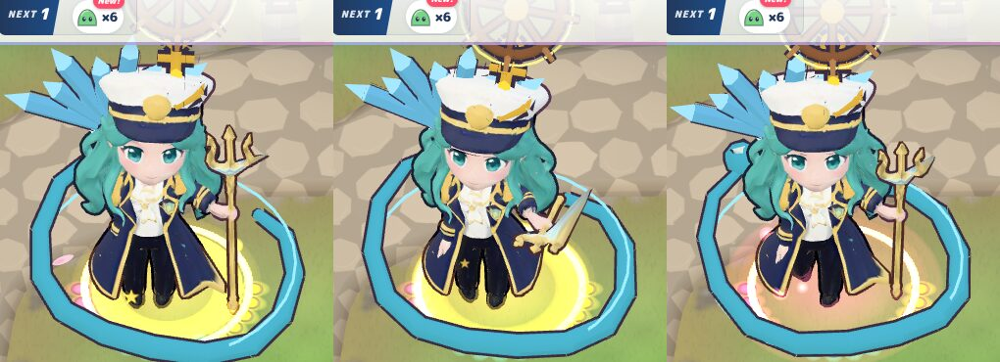
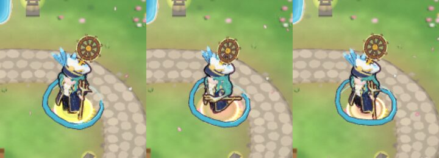
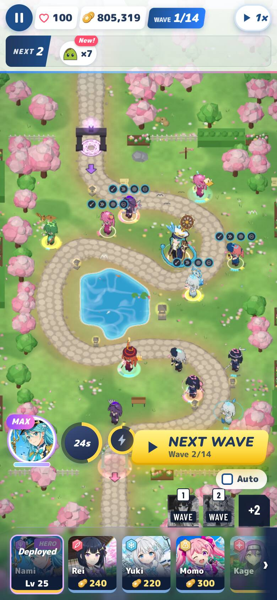
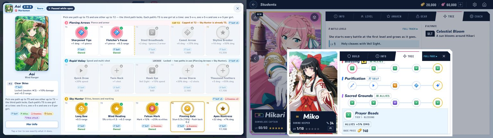

# Path looks, review round 3 (delta)

Reviewed: `feature/path-looks` `b7e114ce` → `2678a226`. The commit holds the fixes for the r2 LOWs. `main` @ `2dba8b4a`
is already merged in. I tested in a scratch worktree and did not push to `main` or the feature branch.

**Verdict: OK for v0.1.73.** Nami, the per-girl draw-call gate, muzzles, the sim id and the tests all check out. The one
gap is that the path-colour fix covers only part of the UI (LOW-1 below). That is a small CSS follow-up, LOW as in
r2, and I recommend folding it into the v0.1.73 cut.

## What changed and what I checked

| r2 finding | Change | Verified |
| --- | --- | --- |
| LOW-1 Nami's loop | Undertow ring (T3) and serpent (T5) moved to `root` at y 0.14 / 0.16, untilted, a little wider | **Fixed.** At Lv 25, in idle, attack and walk, at 1280×720 and 390×844 (shots below), the loop swirls around her feet like a ground ripple. From the 48° camera its back arc passes behind her legs and its front arc stays below her knees. It no longer crosses her coat, her body or her face. On the phone it still reads as her water path. |
| LOW-2 board gate | **Every** piece is in one skinned mesh per girl. Each animated piece rides two extra bones added under its socket: a fixed holder, then the bone that spins or bobs. Each girl gets her own `Skeleton` with an identity inverse for those bones. The gate is now per girl. | **Fixed.** I checked the skin math: an animated vertex `bindMatrix⁻¹·p` on its bone lands at `bone.matrixWorld·p`. On low, **every girl is 1 call**; Nami at Lv 25 is 2 meshes on medium (mesh + hull). Boards: **rollout** (Rei, Yuki, Momo, Kage at T5) **+12**; **all-T5** Aoi/Akane **+12**; **mixed** **+10** (r2: +17, +14, +12). The e2e gate (≤ 2 a girl, heroes ≤ 3) and the unit test (`pieceCalls` = 1 at every set, both boards ≤ 16) pass. The per-girl bones and skeleton are freed on rebuild, sell and quality change (`PathLooks.release` from `Actors._disposeView`, then `_clear` and `skeleton.dispose()`). The new bones are named `pathLookHolder` / `pathLookAnim`, so they can't collide with `findBone` or clip bindings. |
| LOW-3 info-page colours | `unit-info.css` `.ut-row` / `.p1` / `.p2` changed to pink, cyan and deep gold | **Partly fixed:** see LOW-1 below. |
| NIT-2 glow shadows | `customDepthMaterial` that discards `aGlow` vertices | **Fixed** (code). |

A real 13-girl board (1-2, Nami Lv 25, 390×844) and the same on 2-1 at both viewports showed 0 page errors:

## Checks

| Check | Result |
| --- | --- |
| `simId()` | **`e4001588f40b`**, unchanged. `COOP_PROTOCOL` stays at 17. |
| `npm test` | **7,097 passed, 11 skipped** (446 files). |
| `e2e/path-looks.mjs --only muzzle` | **All passed.** Clear at 390×844 and 1280×720: Aoi, Akane, Yuki and Momo 180/180; Luna and Nami 90/90. Spinning pieces now ride extra bones, and they still don't block a muzzle. |
| `e2e/path-looks.mjs --only perf` (rollout, allT5, mixed) | **All passed** (numbers above). |
| `node e2e/smoke.mjs` | **ALL SMOKE CHECKS PASSED.** |
| `e2e/unit-info.mjs --no-coop` | 189 ok, 7 failed. These are **the same 7 on untouched `main` `2dba8b4a`**: Glance gear slots, the Blessing chip text, the stage-prep "Add", and a touch scroll. All are older drift and none are colour checks. |

## Findings

- **LOW-1: the shared colour set is only partly applied.** The battle tree's path rows (`.ut-row`) now read pink, cyan
  and gold. The other surfaces that draw a path colour still use the old set (left: the battle tree, fixed; right: the
  girl sheet's Tree tab, not fixed):
  - `src/ui/styles/tree-grid.css` `.ug-row, .ugp` (`#ff5d73`), `.p1` (`#2b7fff`) and `.p2` (`#a86bff`). This is the
    shared tree grid (`src/ui/treeGrid.js`) on the girl page's Tree tab and the hold sheet.
  - `src/ui/styles/unit-info.css` `.ut-detail` / `.p1` / `.p2` (`#ff5d73`, `#2b7fff`, `#8b5cf6`). This is the tier
    detail card inside the battle tree, so a path 2 tier opens a blue card under a cyan row.

  Use the same values as `.ut-row` (`#ff6b8b`; `#0ea5d8`; deep gold `#d99a00` for the bars and the `--pc` fills).
  That is about five CSS lines, display only, with no sim id change.

  
- **NIT:** with spinning pieces, each girl wearing one now carries her own skeleton (one more bone texture upload a
  frame). The layer's own CPU cost stays at 0.1–0.2 ms a frame for 12 girls, so this is fine.

## Method

The scratch worktree is at `2678a226`, run under Chromium with SwiftShader. I ran the author's `e2e/path-looks.mjs`
(muzzle and three perf boards), `e2e/unit-info.mjs` on this commit and on `main`, smoke, and my review driver (Nami at
Lv 25 at both viewports, and real boards on 1-2 and 2-1).
