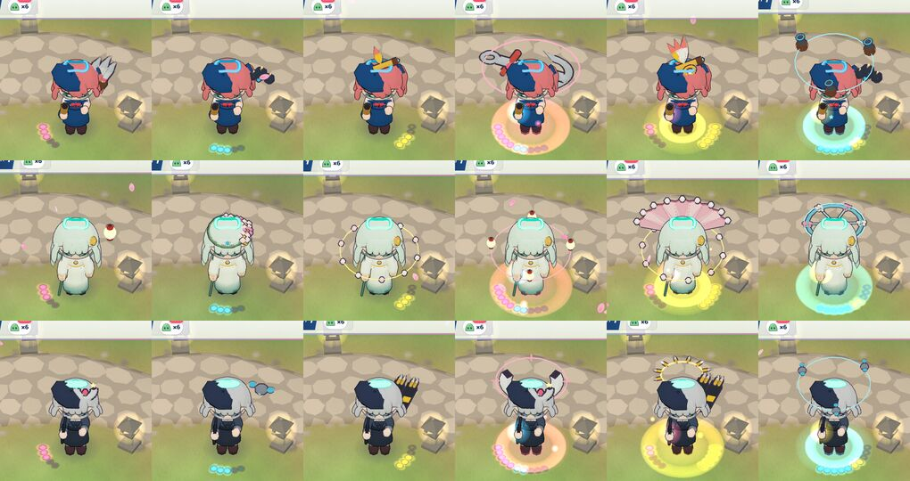
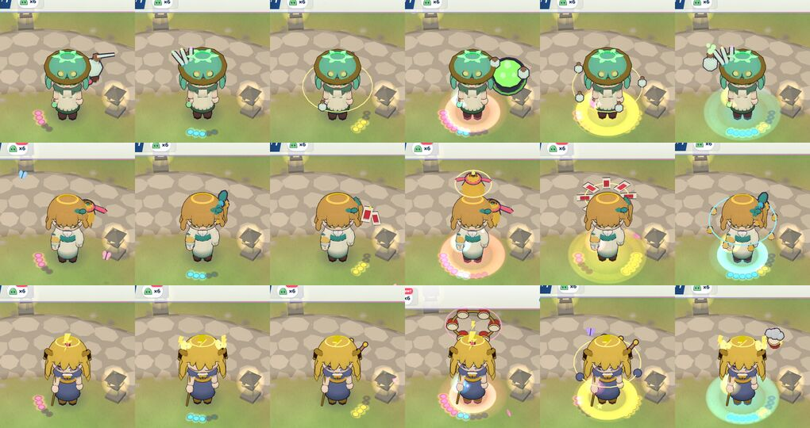
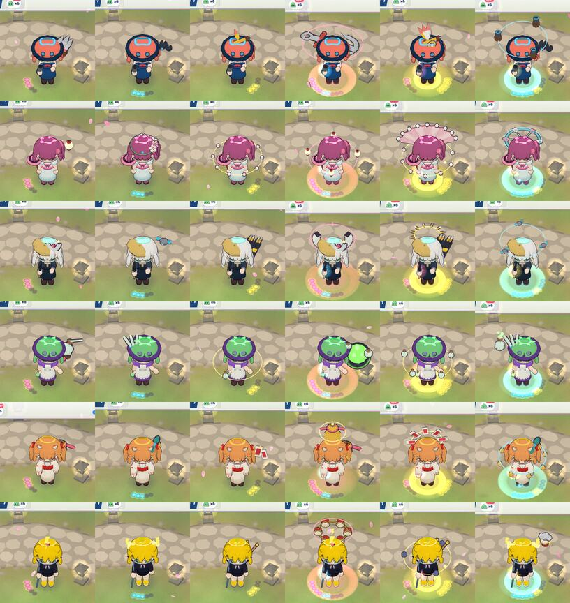
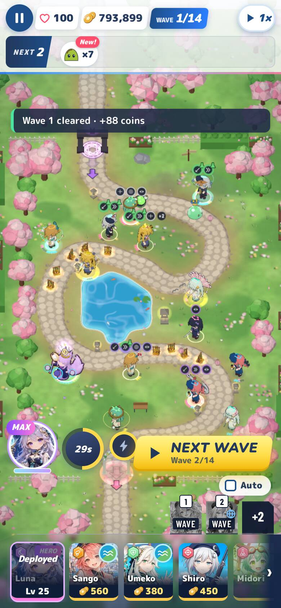
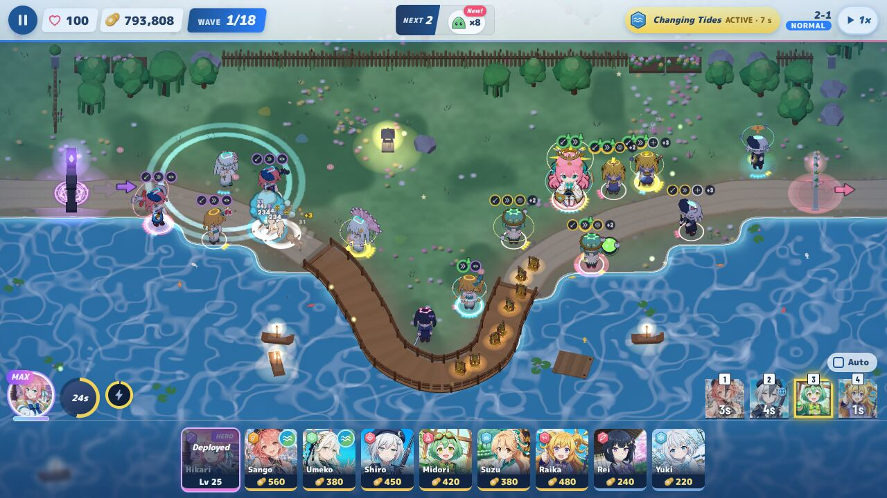

# Path looks, review round 4: rollout batch 2

Reviewed: `feature/path-looks` `d3508098` → `47769b8d` (Sango, Umeko, Shiro, Midori, Suzu, Raika; the muzzle test change).
I tested it merged onto `main` @ `b207fe9` (v0.1.72) in a scratch worktree. The merge is clean, and v0.1.72 touches
none of the path-look files. I did not push to `main` or the feature branch.

**Verdict: NOT OK, for one reason.** The muzzle test's new "hidden by her own figure" rule also hides blocks caused by
pieces, and it is currently masking a real one: Shiro's spotter drones cross her rifle muzzle. Everything else in
batch 2 is ready. Both fixes are small (§1).

## 1. The muzzle test change (required fixes)

**The idea is sound.** If her own figure already hides the tip from the camera, a piece in front of it hides nothing
the player could have seen. Umeko's staff head resting behind her hair is a real case: with the bug below fixed, she
still has 4–7 such frames out of 180 at 390×844, and 0 at 1280×720.

**The implementation masks piece blocks** (`BattleRenderer.pathLooksMuzzleBlocked`). The "own figure" list is every
mesh of her model whose *own* name does not start with `pathLook`. The merged piece mesh made in `pieces.js`
`mergedPieces` (`new THREE.SkinnedMesh(...)`, line 308) has an **empty name**; only its parent group is
`pathLook:merged`. So the piece mesh lands in the "own figure" list. Any ray that hits a piece then also "hits her
figure" and returns `'hidden'`, so a piece-caused block can never fail the gate.

Proof (Shiro at 0-5-2, 390×844 DPR 2, 600 frames with attack swings every 10 frames):

| Tree | clear | `'hidden'` | blocked |
| --- | --- | --- | --- |
| `47769b8d` as shipped | 587 | **13** | 0 |
| the same, plus one line skipping meshes with a `pathLook*` ancestor in the figure list | 590 | **0** | **10 (`p1_drones`)** |

With that one-line fix, `e2e/path-looks.mjs --only muzzle` for batch 2 reports:
- Shiro **179/180** at 390×844 (blocked: `0-5-2 p1_drones ×1`) — **FAIL**;
- Umeko 173/180 + 7 hidden (pass);
- Sango, Raika 180/180;
- all four clear at 1280×720.

In the shipped tree the same run passes only because the drone frame happened not to be sampled (it is ~1.7 % of
frames). In the 600-frame sweep it shows up as `'hidden'`.

**Required:**
1. **HIGH: fix the figure list.** Give the merged meshes names (for example `pathLookMesh` / `pathLookHull`) in
   `mergedPieces`, or skip any mesh with a `pathLook*` ancestor. Naming them also protects `bodyMesh()` and any later
   traversal. Add a regression test that a piece-only block returns the piece's name, not `'hidden'`. For example:
   stage a muzzle point straight behind a piece, or give the test a girl whose figure cannot hide her tip, and assert
   0 `'hidden'` frames for her.
2. **MEDIUM: Shiro's Spotter T4/T5 drones** (`p1_drones`, root `[0, 0.95, 0]`, scale 1.0, spin 0.5) pass between the
   portrait camera and her rifle muzzle in about 1.7 % of frames. Raise the orbit, widen it, or tilt it so it clears
   the barrel line from the 48° camera. Then re-run the muzzle check, plus a longer sweep (≥ 600 frames) for her.

## 2. Batch 2 in the real game

Default outfits, close at 1280×720 (each row 3-0-0, 0-3-0, 0-0-3, 5-2-0, 2-0-5, 0-5-2; Sango, Umeko, Shiro):

(Midori, Suzu, Raika): 

Sentinel outfits (same sets; Sango, Umeko, Shiro, Midori, Suzu, Raika): 

Real 14-girl boards: 1-2 at 390×844 with Luna Lv 25, and 2-1 at 1280×720 with Hikari Lv 25:

 

- **Each path reads**, with distinct silhouettes per path:
  - Sango: steel shells, anchor; bombs, mortars; spyglass, captain's plume.
  - Umeko: lanterns; plum crown, petal wheel; pearl ring, clam fan.
  - Shiro: beret badge, moon; one drone, three drones; magazines, bullet halo.
  - Midori: alembic, cauldron; test tubes, fumes flask; potion bottles.
  - Suzu: bell, great bell; bell ribbons, bell ring; seals, seal circle.
  - Raika: bolt clip, drum ring; horn sparks, storm cloud; drumsticks, storm orbs.
- On the phone, the T5 pieces and auras read clearly. The T3 head pieces (Shiro's badge, Suzu's ribbons, Raika's
  sparks) are small and read mostly by their pips and colour, as in batch 1.
- **Faces are clear** in every close-up, both outfits, and the phone crops. Head pieces sit on top, at the side, or on
  a hat or beret.
- **Hair and Midori's hat:** nothing is lost behind them. Midori's test tubes and alembic stick out beyond her hat
  brim on both outfits, and her cauldron and fumes float beside her. Sango's spyglass and plume sit on top of her beret.
- **Raika:** every piece sits on her left (+x: sticks, storm cloud) or on her centre line (bolt, sparks, drum ring,
  orbs). Nothing goes on her staff side. Her muzzle is clear in 180/180 frames at both sizes.
- **Sentinel outfits** need no outfit rows. Every piece sits correctly on all six Sentinel looks. Midori's Sentinel
  hat is the same shape, and Sango's beret takes the plume.
- **Pieces follow the animations** (the author's idle, attack and walk frames, and the boards in motion).

## 3. Gates and tests (merged tree)

| Check | Result |
| --- | --- |
| `simId()` | **`e4001588f40b`**, unchanged. `COOP_PROTOCOL` stays at 17. |
| Per-girl draw-call gate: batch-2 T5 board (`--board rollout --girls sango,umeko,shiro,midori,suzu,raika`, low) | **1 call every girl**, board **+12**, 698 triangles a girl. Pass. |
| All-T5 Aoi/Akane board | 1 a girl, +12. Pass. |
| `npm test` | 7,134 passed, 1 failed: `tests/sim/perf.mirror.test.js`, a wall-clock ratio (3.27 vs ≤ 3) measured while my browser runs loaded the CPU. Run alone: **2/2 pass**. Path looks don't touch the sim. |
| `e2e/path-looks.mjs --only close` (both outfits, all six) | All passed. |
| `e2e/path-looks.mjs --only phone --phoneSet batch2` | All passed. |
| `e2e/path-looks.mjs --only muzzle` (batch 2) | Passes as shipped. Fails with the figure-list fix (§1). |
| `node e2e/smoke.mjs` | **ALL SMOKE CHECKS PASSED.** |
| My stage boards (1-2 phone and desk, 2-1 phone and desk) | 0 page errors. Each girl fetches only the path files she has at T3+. |

## 4. Content

The pieces are props, ornaments and friendly floaters: shells, an anchor, bombs and mortars, a spyglass, lanterns,
plum blossoms, a petal wheel, pearls, a clam shell, a beret badge, a moon, drones, magazines, potion glassware,
bells, ribbons, paper seals, a bolt clip, drums and a storm cloud. None of it is clothing on the body. All of it is
wholesome, with no other games' or anime names.

## Method

Scratch worktree `47769b8d` + `main` `b207fe9`, run under Chromium with SwiftShader. Runs:
- the author's `e2e/path-looks.mjs` (close for both outfits, phone batch 2, perf on the rollout and all-T5 boards,
  and muzzle on the shipped tree and on a copy with the one-line figure-list fix);
- a 600-frame sweep script calling `pathLooksMuzzleBlocked` on both trees;
- my stage-board driver;
- smoke and `npm test`.
