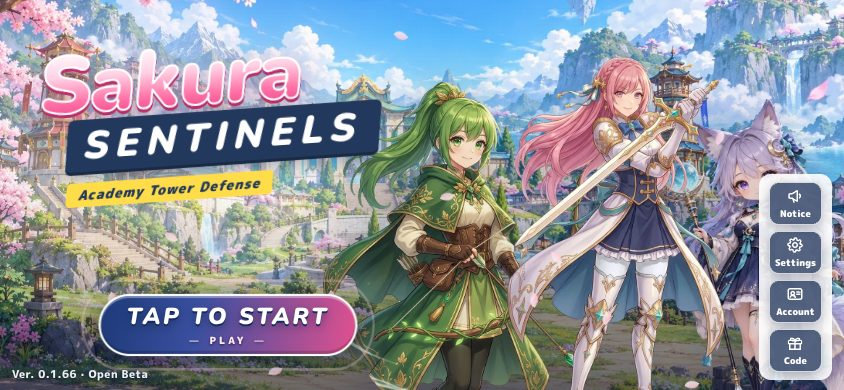
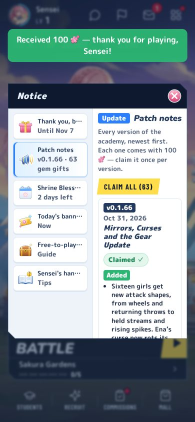
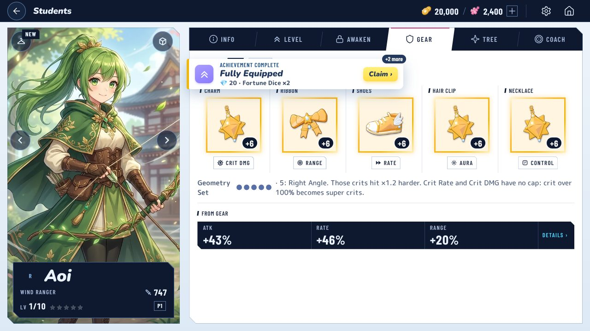
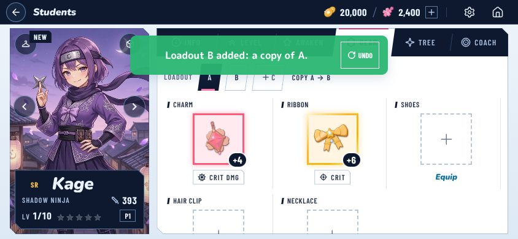
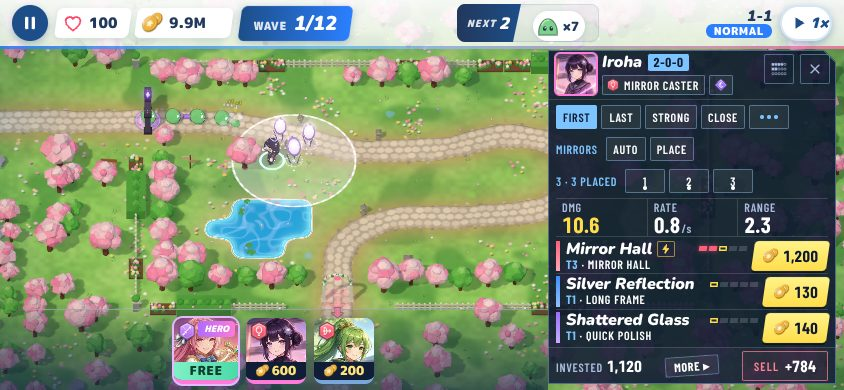
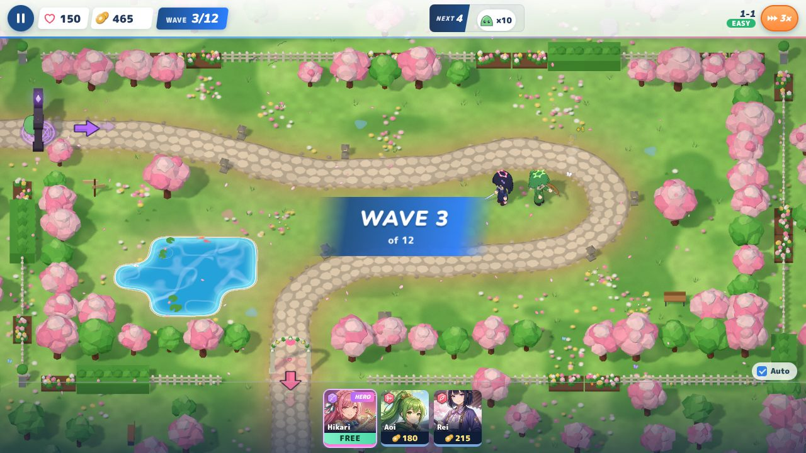

# v0.1.66 — post-deploy live check

**Verdict: PASS**

- **Live:** https://tacosonmondays-pixel.github.io/sakura-game/ — `version.json` read `0.1.66`, build `fc978aba885e`, sim `b2ff5e0e884b`, built 2026-10-31T06:05:54Z. First seen at 06:06:28 UTC, about 10 min after the push (deploy run #66).
- **Browser:** headless Chromium 153 with SwiftShader (software WebGL). Every page loaded with `?online=local`, so no test player signed in to the live project.
- **Viewports:** 390x844 and 844x390 (touch), and 1280x720 (mouse).

## Requests (fresh save, one full pass per viewport)

Each pass covered title → opening (skipped) → 1-1 to wave 3 → lobby → Notice → gift claim → reload → Build Coach → gear tab.

| Viewport | Requests | Non-200 | Failed |
|---|---|---|---|
| 390x844 | 400 | 0 | 0 |
| 844x390 | 401 | 0 | 0 |
| 1280x720 | 400 | 0 | 0 |
| v0.1.65 save load (1280x720) | 190 | 0 | 0 |

No page errors and no console errors in any pass. The ignore list covered only the usual headless GPU noise (ReadPixels stall, SwiftShader fallback).

## Checks

| Area | Result |
|---|---|
| Title | TAP TO START enables at all three sizes; the version reads "Ver. 0.1.66 · Open Beta" |
| Patch note | At all three sizes, the top entry of Notice → Patch notes is **v0.1.66 · Oct 31, 2026 · Mirrors, Curses and the Gear Update** |
| Gem gift | Claim gave +100 (2,400 → 2,500) and the button turned to "Claimed ✓". After a reload the version still reads Claimed ✓ with no Claim button, and gems stay 2,500. Checked at all three sizes |
| Fresh save, 1-1 | Hikari's opening skipped, coach skipped, 2 girls placed. Played in real time at 3× to wave 3 of 12 with all 150 lives, at all three sizes |
| Build Coach | The Coach tab opens on Aoi ("BUILD 100 MAX 5") at all three sizes. `e2e/buildCoach.mjs` against live: **99/99 ok** (Set as Main, steps, To max, Farm, Gear plan, path toggle, home news chip, Stage Prep tag) |
| Gear | Gear tab opens. `e2e/gear-slots.mjs` against live: **26/28 ok** (five slots worn, set line, Hair Clip picker). The 2 misses are a harness artefact, explained below |
| Limit Break | `e2e/limit-break.mjs` against live: **36/36 ok**. Limit Break shows on the slot sheet and on the Backpack's piece sheet, Set LR and Blank LR work, the Nightglass Lens "Use" lists the ready spare, and the LR Set Form reaches her battle stats |
| Loadouts | `e2e/teams.mjs` against live: **128/128 ok**. Team chips switch, Loadout B is added as a copy, switching moves the lent charm with its takes list, Undo works, and the Stage Prep Team chip works |
| Iroha mirrors | `e2e/iroha-mirrors.mjs` against live: **81/81 ok** at all three sizes. The save is seeded with Iroha at Mirror Hall tier 2. PLACE walks mirrors 1–3, the chips re-place, and Auto puts them back. Bolts bounced off mirrors in a wave, and no null/NaN text or console errors appeared |
| v0.1.65 save | Loads in v0.1.66 without loss. See below |

### v0.1.65 save

The save was **written by the live v0.1.65 game** before the deploy. The `mid` veteran from `tests/fixtures/veterans.js` was built with v0.1.65 code (c34f7bd3), loaded into live v0.1.65 and saved by it: 20 girls, 104 gear pieces, Act I clears and achievements. After the deploy the same `localStorage` was loaded into live v0.1.66 and saved again:

- 20 → 20 girls; levels, stars and potential identical.
- Coins, gems and every item count identical.
- The 104 gear pieces, stage clears and achievements are identical.
- No top-level key dropped.
- No `.backup` written and no backup/lossy notice shown.
- No errors.

## Notes (not blocking)

1. **gear-slots, 2 misses: harness artefact, not a live bug.** Those two checks open the Set Box picker by importing `/src/ui/gearUr.js`. That module doesn't exist on the live build, so for this check it was served from a local dev server. The dev copy has its own `store` (`src/ui/gearUr.js:8`), which never saw the test's in-page change that puts Momo first, so its note reads "For Aoi". The unmodified script on local dev with the same code passes **28/28**.
2. **A reload straight into the lobby at 1280x720 can block the main thread for up to ~35 s under SwiftShader.** `load` fires at ~5 s, then the page answers nothing until the lobby is up. Seen twice on live (one live run timed out); the final live run took 3.9 s. A/B on local production builds of the same steps gives v0.1.65 at 30 s and v0.1.66 at 33–36 s, so this is **not a v0.1.66 regression**. It is most likely the lobby's 3D scene on software WebGL in this 4-core sandbox. Phone sizes did not hit it. It may be worth a look on a low-end desktop GPU.

## How this was run

- **Fresh-save pass and save check:** a one-off Playwright script (not committed) against the live URL.
- **Feature checks:** live copies of `e2e/{iroha-mirrors,gear-slots,limit-break,teams,buildCoach}.mjs` with `base` pointed at the live site. Their seeding helpers import `/src/...` modules, and those requests were routed to a local Vite dev server on the same commit (fc978aba). The game itself was always the live build.

## Screenshots

| | |
|---|---|
|  Title, 844x390 |  Patch note v0.1.66 claimed, 390x844 |
|  Gear: five slots, Geometry Set, 1280x720 |  Loadout B added, 844x390 |
|  Iroha with three mirrors placed, 844x390 |  Fresh save, 1-1 wave 3, 1280x720 |
