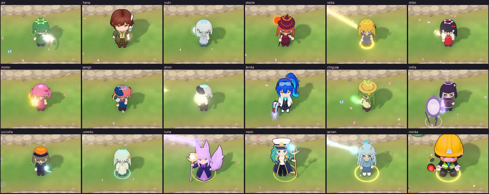
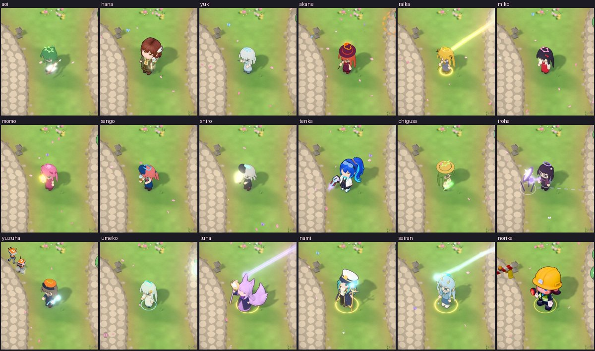

# Weapon muzzles — independent review r1

Branch `feature/weapon-muzzles` @ `a3f520e` (base `fix/enemy-rigs` f3e3099 + main df9fae8). Reviewed 2026-11-01.

**Verdict: OK.** There are no blockers. The nits below are optional.

## 1. Sim id

`e4001588f40b` on the branch, on main df9fae8 and on the merge with `fix/slime-goblin-faces`. `COOP_PROTOCOL` is unchanged (17).
The diff touches only `src/models`, `src/render/attackFx`, tests, e2e, docs and the patch note.

## 2. Merge with `fix/slime-goblin-faces` (cb53021)

A scratch merge of cb53021 into a3f520e is **clean, with no conflicts**. Neither branch touches the other's
lines in `glbChibi.js`, `actors.js` or the tests. Only the sibling changes `actors.js` (the rigid-face squash),
and only this branch changes `glbChibi.js` (one import and the `attachWeaponTip` call). On the merge, `npm test`
gives 445 files and 7082 tests, all passing, and the sim id is unchanged.
Note: the merge carries two small GLB readers for tests, `tests/models/glbSkin.js` (this branch) and
`tests/models/loadGlb.js` (the sibling). They do different jobs (raw skin arrays vs three's GLTFLoader), so
keeping both is fine.

## 3. Real game (Chromium + SwiftShader)

**The branch's own e2e** (`e2e/weapon-muzzles.mjs`, all 18 girls, 1280×720 and 390×844): 205 ok, 0 FAIL, no
console errors. My crops:

**Landing, my own probe.** A real battle at 3×, pinned to a 30 fps cadence (so each frame advances 0.1 s of sim,
the worst realistic phone case). Every drawn frame is read through `attackFxProbe()`.

| Girl | Spawn offset (muzzle↔sim spawn, tiles) | Residual once f′ ≥ 0.6 | Last drawn frame before the hit, off the sim path |
|---|---|---|---|
| Aoi / Hana / Yuki / Akane | 0.39 / 0.33 / 0.28 / 0.90 (Akane: incl. height) | 0.000 | 0 / 0.05 / 0.02 / 0 |
| Miko / Momo / Sango / Chigusa | 0.19 / 0.22 / 0.84 / 0.33 | 0.000 | 0.08 / 0.07 / 0 / 0 |
| Iroha / Yuzuha / Nami / Norika | 1.31 (her panels) / 0.27 / 1.03 / 1.14 | 0.000 | 0.20 / 0.09 / 0.04 / 0 |
| Raika, Seiran (chains), Shiro, Tenka (tracers), Luna, Umeko | no projectile: chain nodes and tracer ends are the sim's points | — | — |

- `maxBlendResidual` is **0.000 for every girl**, at high, medium and low, and for the Sentinels. Once
  f′ ≥ 0.6 the drawn shot sits exactly on the sim path. Main is 0 too.
- **Fast or short shots:** a shot that the sim resolves before f′ reaches 0.6 is last drawn up to **0.2 tiles**
  off the sim path (Iroha, Yuki on medium, Sentinel Yuki on low), then the impact shows on the target. This is
  how the origin blend has always worked, not new behaviour. The gap is a little larger now because the muzzle
  sits further from the sim spawn than the old hand point did (0.2–0.4 vs ~0.22 tiles). It doesn't read as
  wrong at 3×. Not a blocker.
- **Inside the body / behind the camera:** no tip is behind the camera. Every tip is at least 0.25 tiles up and
  most are in front or to the side. Yuki's and Akane's staff heads are about 0.1 tiles further from the camera
  than their chest centre (the staff is held upright, slightly back). Their glow still shows beside the head in
  every crop.
  **Shiro:** her rifle runs forward from the grip at waist height (0.25–0.32 of her height), and the tip is
  0.33 H in front of her. A flash in front of her body is therefore correct.
  **Nami:** her tip is the top of the planted trident, 1.46 tiles up, beside her hat. It reads well in the crops.
- **Flash orientation:** Tenka's cone runs down the coilgun barrel, Aoi's and Hana's run out of the bow, and
  Shiro's and Sango's are at the barrel mouth. The staves get a head glow.
- **Quality and LOD:** medium and low use the LOD file. The measured tip matches high: Yuki's local tip is
  identical to within 0.001.
- **Fallbacks:**
  - Coilgun GLB blocked: Tenka shows empty-handed with no anchor and falls back to the old fixed offset. The
    only console output is a warning, no errors.
  - Character GLB blocked (Aoi, Shiro): they show as procedural figures with no anchor and use the hand point.
    Shots still blend.
  - Props load before the asset resolves, so "prop still loading" is really "prop failed" — covered above.

## 4. Regressions

- **The 14 unchanged girls and the duo:** `ctx.muzzle` returns null for an unlisted asset and for `ud.duo`, so
  `hand()` takes the old path exactly. The attack-fx gallery (19 girls, max builds) passes with no console
  errors, and its quads and styled counts match main.
- **Sentinels:**
  - Aoi, Yuki, Raika, Miko, Sango and Shiro on low: each has an anchor on her `sentinel-*` asset, residual 0, no
    errors.
  - Akane's and Umeko's Sentinel outfits (fan, parasol) get no anchor, as the spec says. So does Momo's
    (no mic).
- **Future:** `future-mizuha` is not placeable in battle (the future figures are teasers). Only the unit test
  covers it: its full and LOD files resolve a tip on the trident.
- **Smoke:** ALL SMOKE CHECKS PASSED (681 ok).

## 5. Perf

- **attack-fx `--quick`:** the "draw calls 749 ≤ 747 + 1" fail **reproduces on main df9fae8 (749)**, so it is
  pre-existing.
  - On the branch, run alone: 749, the same as main.
  - A first branch run shared the machine with another e2e and gave 750. That was noise.
  - Stress attack-FX CPU on the branch is 0.447 ms (limit 1.5).
- **24 armed girls, low tier, 390×844, 3×:** attack-FX 0.075 ms per frame on the branch vs 0.047 ms on main
  (+0.03 ms).
  - Frame p50 is 258 vs 266 ms. That is SwiftShader and GPU-bound, so it's noise.
  - The anchor getter calls `updateWorldMatrix(true, false)` on every read, which is cheap at this count.

## 6. Tests

- `npm test`: 444 files, 7058 tests passed (11 skipped). On the merge: 7082 passed.
- e2e:

| e2e | Result |
|---|---|
| `weapon-muzzles` | pass |
| `smoke` | pass |
| `attack-fx --quick` | only the pre-existing draw-call fail |
| `model-quality` | 9 FAIL, exactly the expected slime/goblin "own model" checks (paused on main); nothing else fails |

## 7. Patch note (v0.1.71 draft)

It is accurate and player-facing. One nit: "Gun and bow shots flash at the muzzle" — a bow has no muzzle.
Suggested wording: "Gun and bow shots flash along the weapon; staves glow at the head when they cast."
The combined note will also need a line for the base branch's figure fix (92933fb: Luna and the batch-2 heroes
no longer T-pose). That fix ships with v0.1.71 but isn't on main yet.

## Nits (optional, none blocking)

1. The e2e's tip check compares the visual muzzle with the anchor it was read from, so it is nearly
   tautological. It doesn't check landing. Asserting `stats.maxBlendResidual === 0` after the wave would
   cover that cheaply.
2. Sango's smoke puffs still add +0.1 / +0.15 above the tip (no `tipUp`). That looks deliberate (smoke rises),
   just noting it.
3. Owner feedback during this review, out of scope here: Norika's figure "looks nothing like the others". She
   is a Tripo batch-1 figure (oversized hard hat, different proportions), already live and unchanged by this
   branch. Worth a separate re-model task.
